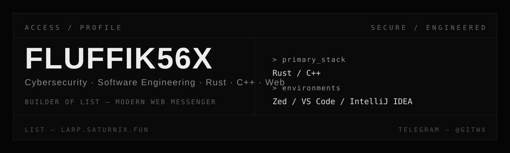

<div align="center">



<br />

<a href="https://larp.saturnix.fun/index.php?u=fluffik56X">
  
</a>
&nbsp;
<a href="https://t.me/gitwx">
  
</a>

</div>

<br />

```text
┌──────────────────────────────────────────────────────────────┐
│  IDENTITY                                                    │
└──────────────────────────────────────────────────────────────┘
```

### Cybersecurity engineer · Software engineer

Работаю на стыке **кибербезопасности**, системной разработки и современных веб-продуктов.  
Пишу на **Rust** и **C++**, проектирую надёжные системы и создаю веб-сервисы с фокусом на архитектуру, безопасность и пользовательский опыт.

> Создатель **List** — современного веб-мессенджера.  
> <https://larp.saturnix.fun/index.php?u=fluffik56X>

<br />

```text
┌──────────────────────────────────────────────────────────────┐
│  OPERATING FIELD                                             │
└──────────────────────────────────────────────────────────────┘
```

<table>
  <tr>
    <td width="50%" valign="top">

### Security

- Безопасная разработка и анализ программных систем  
- Безопасность веб-приложений  
- Архитектура с учётом угроз и границ доверия  
- Инженерный подход к надёжности и устойчивости  

  </td>
  <td width="50%" valign="top">

### Engineering

- **Rust** — производительные и безопасные системы  
- **C++** — системный уровень и производительность  
- Backend, архитектура сервисов  
- Современные веб-приложения и продукты  

  </td>
</tr>
</table>

<br />

```text
┌──────────────────────────────────────────────────────────────┐
│  TOOLCHAIN                                                   │
└──────────────────────────────────────────────────────────────┘
```

<div align="center">

| Languages | Environments | Direction |
|:---:|:---:|:---:|
| `Rust` `C++` | `Zed` `VS Code` `IntelliJ IDEA` | `Security` `Systems` `Web` |

</div>

<br />

```text
┌──────────────────────────────────────────────────────────────┐
│  PROJECT — LIST                                              │
└──────────────────────────────────────────────────────────────┘
```

### List

Современный мессенджер, разработанный как самостоятельный веб-продукт.

| Параметр | Описание |
|---|---|
| Тип | Веб-мессенджер |
| Ссылка | [larp.saturnix.fun](https://larp.saturnix.fun/index.php?u=fluffik56X) |
| Фокус | Современный интерфейс, коммуникация, практичная веб-разработка |
| Роль | Идея, разработка, продукт |

<details>
<summary><b>Подход к разработке</b></summary>

<br />

- Сначала понятная архитектура, затем интерфейс  
- Безопасность рассматривается как часть продукта, а не отдельная функция  
- Код должен быть читаемым, предсказуемым и поддерживаемым  
- Интерфейс должен быть быстрым, ясным и без визуального шума  

</details>

<br />

```text
┌──────────────────────────────────────────────────────────────┐
│  CONTACT                                                     │
└──────────────────────────────────────────────────────────────┘
```

<div align="center">

| Channel | Endpoint |
|:---:|:---:|
| **List** | [`larp.saturnix.fun`](https://larp.saturnix.fun/index.php?u=fluffik56X) |
| **Telegram** | [`@gitwx`](https://t.me/gitwx) |

</div>

<br />

<div align="center">

```text
──────────────────────────────────────────────────────────────
 SYSTEMS · SECURITY · RUST · C++ · WEB
──────────────────────────────────────────────────────────────
```

</div>
